## pingem ...and this is how I discovered that my neighbors are flooding the
wifi bands so badly that it's severely impacting my service. It's across all
bands, so I'm in the process of dragging cable everywhere.  
# Installing/running
The ICMP agent is now `user_icmp`, a small C++11 daemon (Linux only). Build it
and start it as root:

    cd user_icmp
    make
    sudo ./user_icmp

It needs root for exactly one thing: opening a raw ICMP socket. It opens that
socket, opens its listening socket (`@user_icmp`, a Unix socket with no file
on disk), and then permanently drops to `nobody` before it reads a single byte
from anyone. Everything else - the protocol parsing, DNS, all client input -
runs unprivileged. (Instead of sudo,
you can `sudo setcap cap_net_raw+ep user_icmp` and run it as yourself. It then
clears that capability as soon as the raw socket is open, and in both cases
it checks that it can no longer open another raw socket before going on. Note
that every rebuild loses the capability, so rerun setcap after `make`; and
file capabilities are ignored on filesystems mounted `nosuid`.)

Options:
* `--user NAME` - who to become after startup (default nobody)
* `--min-interval S` - fastest any client may ping a target (default 0.1 s)
* `--reply-expiry S` - forget unanswered packets after this long (default 60 s)

(pingem started out as a browser page, pingem.html, fed by a Python agent,
user_icmp2.py, that ran entirely as root. Both have been retired in favor of
the C++ daemon and the graphical client below.)

# The graphical client
`clients/pingem` is a native OpenGL client (SDL2 + Dear ImGui) that talks to
user_icmp over a Unix socket. It runs from the command line:

    sudo apt install libsdl2-dev               # build dependency
    cd clients
    make
    ./pingem 192.168.1.1 8.8.8.8 amazon.com     # --interval S, --size N, --flows K

Controls: the mouse wheel over a graph zooms around the mouse pointer;
left-click and drag scrubs through time (the epoch you grab stays under the
mouse); End (or F) goes back to following "now"; the View button (or V)
switches the summary column between "combined" and "by flow"; the Scale
button (or L) switches the RTT axis between linear and logarithmic (see
below). At the left of each row's status line, X stops pinging that host and
removes the row, and the route button (a little forking path) opens that
host's route graph (see "Routes" below). R opens the route map with every
host on it. Escape closes the route view, or quits if it isn't open; Q
quits. If user_icmp isn't running, or restarts, the
client keeps retrying and picks up where it left off; the outage shows as a
gap.

Building the client also fetches Mozilla's Public Suffix List into
`~/.cache/pingem/` (once; `make update-psl` refreshes it). The route graph
uses it to turn router names into the domain that owns them. pingem never
downloads anything itself, and works without the list - it just guesses.

**Refused pings.** Sometimes a ping isn't lost but refused: a router answers
it with an ICMP error ("host unreachable", "administratively prohibited"...)
instead of passing it on. Those count as loss, but the loss bar for them is
dotted rather than solid, the statistics show how much of the loss was
refused, and the status line says who refused it and why.

## Flows, and how to read the "by flow" view

(The screenshots in this section are from simulations - see "About the
example images" at the end of the section.)

**The question flows answer.** Look at the histogram in the summary column
(the bars on the right of each row: one bar per latency range, longer bar =
more replies took that long). Often it isn't one smooth hump. It can have two
or more separate humps with a gap between them - say a pile of replies around
14 ms, another pile around 17 ms, and few in between. We'll call each hump a
*clump*. A clump means "there are distinct ways a packet can be delayed, and
each packet gets one of them". The question is: what are those distinct ways?

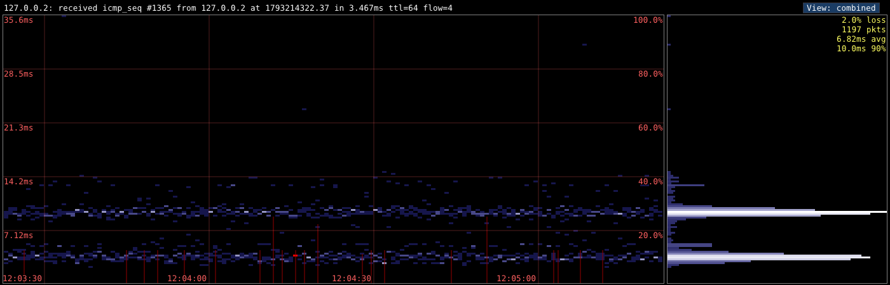

*Two clumps. The graph on the left shows two horizontal bands of replies -
one around 4 ms, one around 10 ms - and the histogram on the right has a
hump for each.*

One common answer is that your packets are taking different routes. Between
you and a big site there are often several parallel paths, and routers spread
traffic over them. Usually they pick the path by hashing fields of the packet
header - so all packets that look the same go the same way, and a slower path
would show up as its own clump.

**What a flow is.** pingem spreads each host's pings over 8 *flows* (round
robin: ping 1 is flow 0, ping 2 is flow 1, ... ping 9 is flow 0 again). Every
ping in a flow is built to have the same ICMP checksum and the same ICMP
identifier, and each flow has its own of both. Routers that hash either one
to pick a path will therefore send every ping in a flow down the same path -
but different flows may go different ways. (Paris traceroute, where the
idea comes from, varied only the checksum; but some balancers - the Comcast
one this was developed behind, for one - hash the identifier instead, and
ignore the checksum.)

**The "by flow" view.** Click View (or press V) and each row's summary column
splits into 8 small histograms, one per flow, numbered 0-7 underneath, all on
the same scale. Hover over one for its statistics; click it to highlight that
flow in the graph (everything else dims, including the other flows' share of
each loss bar).

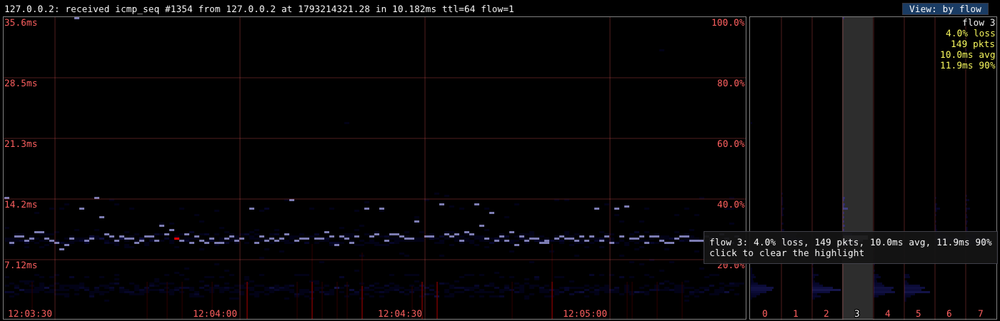

*The by-flow view with flow 3 highlighted: its replies stay bright in the
graph, the rest dim. The tooltip and the numbers in the top right corner are
flow 3's own statistics.*

Now compare the clumps across the 8 histograms:

    Each flow has ONE of the clumps -       Every flow has BOTH clumps -
    the clumps "sort cleanly by flow":      they don't sort by flow:

    flow:  0  1  2  3  4  5  6  7           flow:  0  1  2  3  4  5  6  7
    17ms      #     #        #  #           17ms   #  #  #  #  #  #  #  #
    14ms   #     #     #  #                 14ms   #  #  #  #  #  #  #  #

* **Each flow has only one of the clumps** (left). Flows 1, 3, 6 and 7 always
  take about 17 ms; flows 0, 2, 4 and 5 always take about 14 ms. Since a
  flow's packets all follow one path, and a flow never shows the other clump,
  the clumps *are* the paths: you're being load-balanced over two routes and
  one is about 3 ms slower. (Which flows land where is effectively random -
  it depends on each router's hash.)

  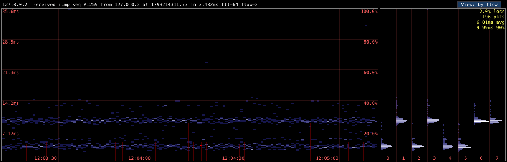

  *Flows 0, 2, 4 and 5 sit only in the fast clump; 1, 3, 6 and 7 only in the
  slow one. Two routes.*

  Highlighting one of the slow flows confirms it: its replies all fall in
  the upper band, and only its share of each loss bar stays bright - in this
  simulation the slow route is also the one dropping packets.

  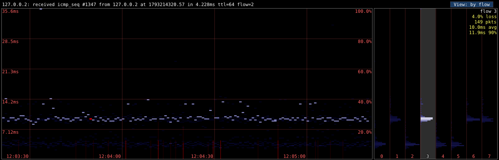
* **Every flow has both clumps** (right). Packets that took the same path -
  same flow - still split into both clumps, so the second clump comes from
  something that varies packet by packet, not from routing. Usual suspects:
  your access link (cable modems wait for permission to transmit on a fixed
  schedule; Wi-Fi retransmits), a busy queue somewhere, or the far end. To
  find out where, add a row for each hop along the way (your router, your
  ISP's first router, ...) and see at which hop the second clump first
  appears. One caveat: if the routers on your path ignore both the checksum
  and the identifier when balancing ICMP (some hash only addresses), flows
  can't separate paths and you'll see this picture even if there are
  several routes. The route view (below) tells those two cases apart.

  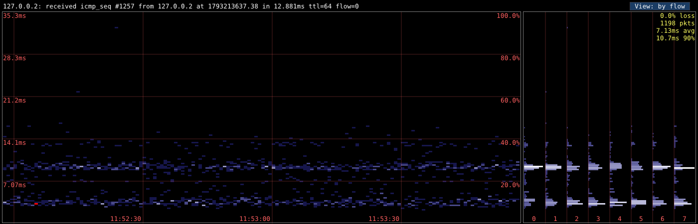

  *All eight flows show both clumps: the delay is chosen per packet, not per
  route.*
* **Something in between** - some flows with one clump, some with both - can
  mean several balancers in a row, or one that spreads individual packets
  rather than flows.

  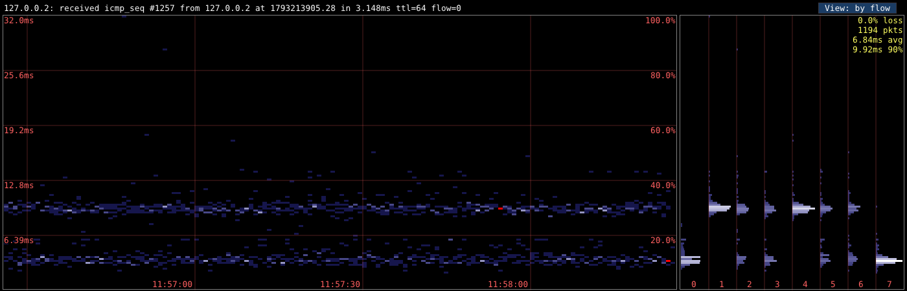

  *Flows 0 and 7 only in the fast clump, 1 and 4 only in the slow one, the
  rest in both.*

`--flows 0` turns flows off and lets the checksum vary with every packet, as
plain ping does (and then routers may scatter your pings over all the paths).

## Finding where the delay comes from: one row per hop

When something is adding delay or jitter, the quickest way to find *where*
is to give pingem one row per stage of the path: your own router, your ISP's
box, the first router on the ISP's side (`traceroute -n 8.8.8.8` shows it as
the first public address), and a server out on the internet. All rows share
one RTT scale, so you can compare them directly: the first row where the
trouble shows up tells you which link added it, and the rows after it should
look like that row, shifted up a little.

That's hard to see on a linear scale, because a sub-millisecond LAN row and a
15 ms internet row don't fit on the same axis - and a single slow reply
anywhere stretches the axis for everyone:

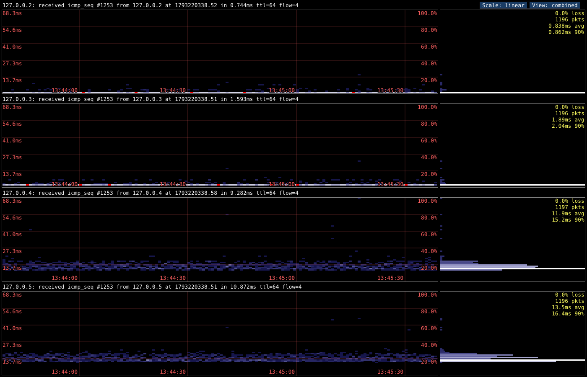

*Linear scale. One 68 ms straggler sets the top of the axis, and the first
two rows are crushed into their bottom few pixels.*

Press L (or click Scale) for a logarithmic axis, where every factor of ten
gets the same height:

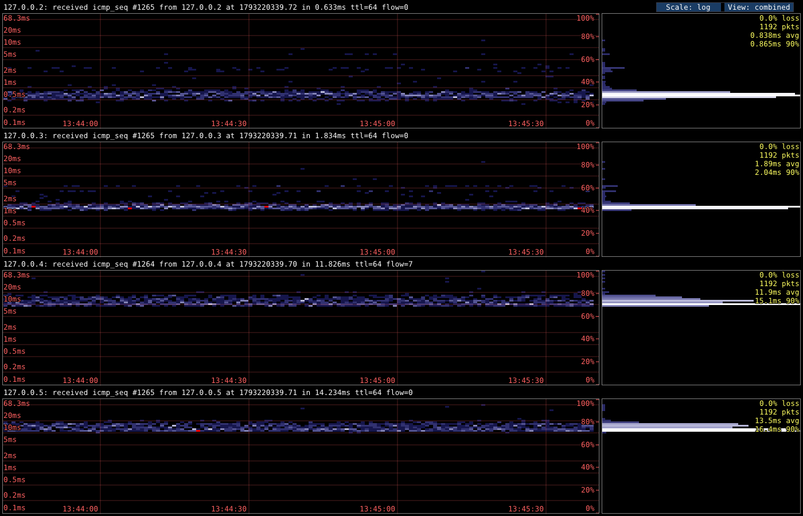

*The same data on a log scale. Now it's plain that the first two hops are
tight (about 0.8 and 1.9 ms), that the delay AND the spread both arrive at
the third hop, and that the fourth just adds a millisecond or two on top. The
link between hops 2 and 3 - in this simulation, a cable modem's upstream - is
the one to look at.*

How the log scale is set up:
* The top is always the slowest reply on screen - the true worst case,
  never trimmed.
* The bottom is the largest power of ten below the fastest reply on screen
  (fastest 8 ms -> bottom 1 ms; fastest 0.5 ms -> bottom 0.1 ms).
* Grid lines sit on round values (1, 2, 5, 10, 20, 50 ms...).
* Loss isn't logarithmic: the loss bars keep their linear meaning, and the
  0-100% ticks on the right edge measure them.
* Each pixel row of the graph and histogram covers the same *ratio* of
  RTTs, so a clump at 50 ms looks narrower than one at 5 ms with the same
  spread in milliseconds.

## Routes: where do the flows go?

Alongside its pings, user_icmp sends each host a slow trickle of *route
probes* - traceroute, done carefully. A probe is a ping with a small TTL
(time-to-live: the number of routers it may cross). The router where the TTL
runs out drops it and sends back "Time Exceeded", which tells us who that
router is. A probe is identical to its flow's pings - same checksum, same
identifier - except for the TTL, so each flow's probes follow exactly the
path its pings take. Probes go out at one per ping
interval normally, four while that host's route graph is open, always spaced
evenly between the pings - never in bursts.

Click a row's route button and that row moves to the top, and the rest of
the window shows the paths to that host:

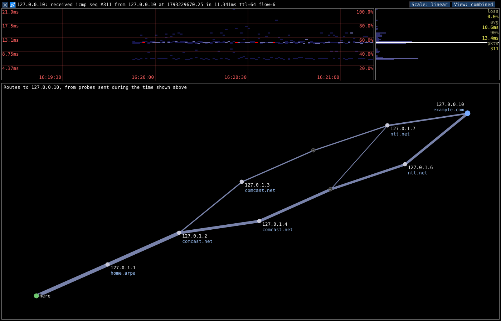

*Your machine ("here") is bottom left, the target top right, and every
router in between, labeled with its address and the domain that owns it.
Lines are links; the thicker the line, the more flows use it. Here the
paths split twice: after 127.0.1.2 (the ISP's load balancer sends some flows
via .3 and the rest via .4), and again after the fourth hop. The "*" nodes
are routers that never answered - many don't send Time Exceeded at all, or
only a few a second. That's normal, not a fault.*

The graph always shows the routes during the time window the heatmap is
showing, so if you drag or zoom the heatmap back to last night, the graph
shows last night's routes. Hovering over a router shows its full name, round
trip times, how many probes it answered, and which flows go through it;
hovering over a link shows its flows.

Click a link or a router to select the flows that use it. They light up in
the graph *and* in the heatmap above, and the statistics switch to just
those flows:

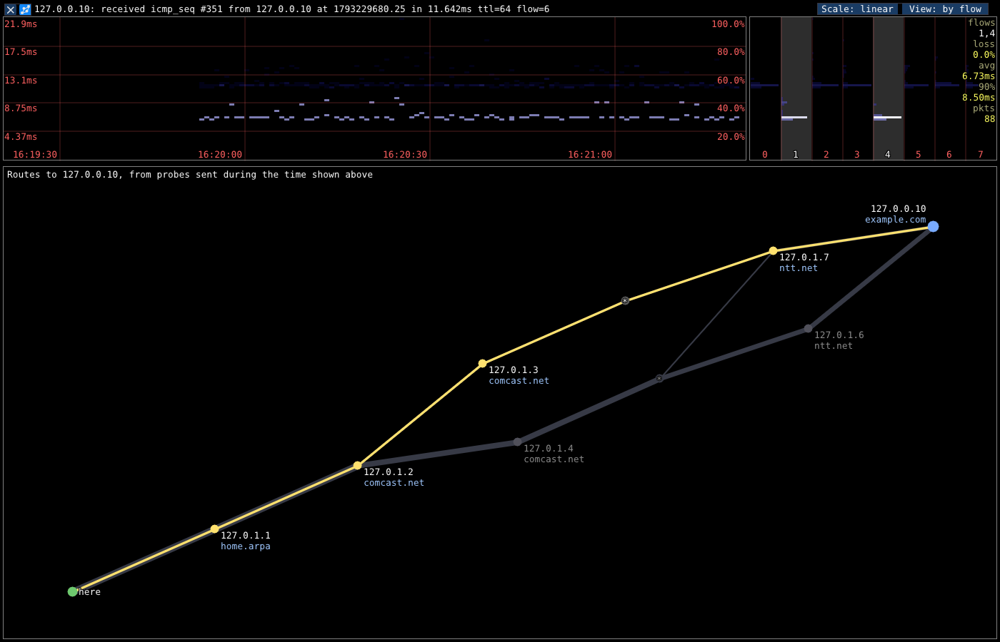

*The link from .2 to .3 is selected: flows 1 and 4 use it. In the heatmap
(and in the "by flow" histograms, right) those two flows are the fast band at
about 7 ms; everything else - the flows going via .4 - is the slower band.
Now we know which path adds the delay.*

In the "by flow" view, hovering over a flow's histogram lights up its path,
and clicking it selects it. Click empty space in the graph to clear the
selection.

A router that *refuses* probes (Destination Unreachable) gets a red ring:

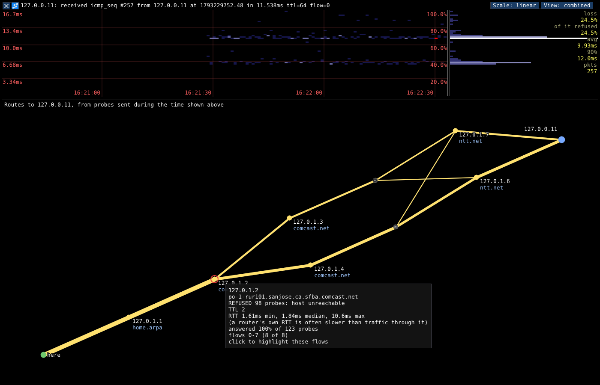

### All the routes on one map

Press R for every host's routes on one map:

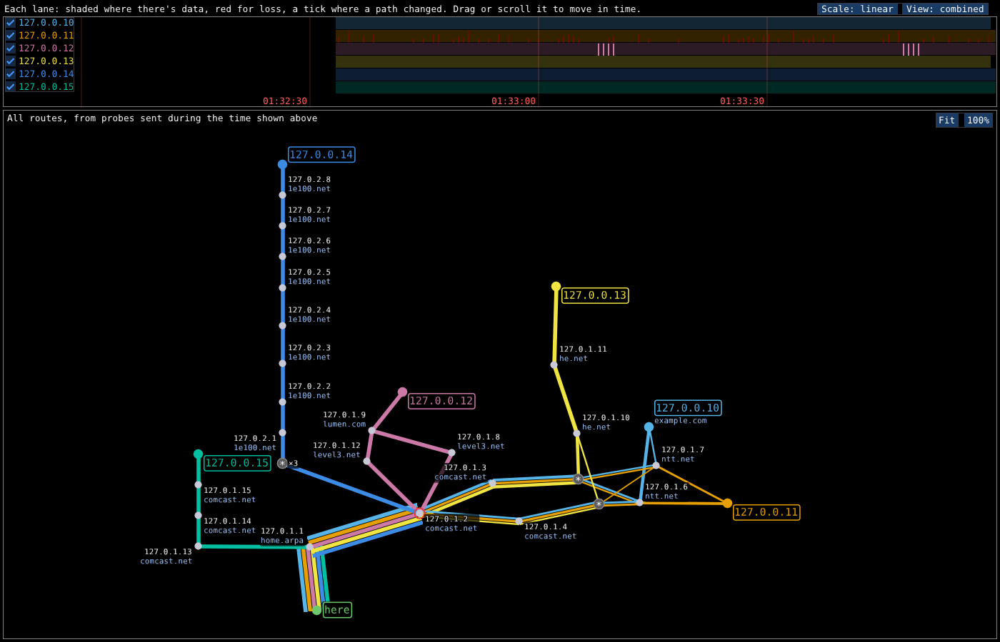

*Six hosts. Each has a color, and ends at a box in that color; "here" is at
the bottom. A router on several hosts' paths appears once, and the link into
it is drawn as parallel stripes - one per host using it, each as thick as
that host's share of the traffic over it - like subway lines sharing a
track. Here 127.0.0.15 leaves the others right after the home router;
127.0.0.12 leaves after the ISP (and flips between two routes every 45
seconds - see the ticks in its lane); 127.0.0.13 shares the load-balanced
hop and then heads off on its own; 127.0.0.10 and .11 stay together until
the end; and 127.0.0.14 - like most big search engines - is behind three
hops that never answer ("*x3") and then a long chain of routers, which is
stacked into a column.*

The heatmaps make way for a time strip at the top, with a lane per host.
Each lane is a squashed copy of that host's heatmap, on its own scale: from
its fastest reply at the bottom to its 99th percentile at the top (the
slowest 1% are drawn at the top), linear or log as the Scale button says,
so even a quiet host shows its texture -
hover over a lane for its numbers. It also has a red bar where pings were
lost, and a tick wherever one of that host's paths changed - usually the
moments worth looking at. (Above, 127.0.0.12's route flips every 45 seconds.) The
strip works like a heatmap: scroll to zoom, drag to move back in time, End
to follow "now" again, and the map shows the routes as they were. Each
lane's name is a checkbox that adds the host to the map or takes it off; with
only one left, you're back to that host's heatmap and graph. A row's route
button opens the same view with just that host, with the checkboxes under the
title to add others.

Hovering over a router lights up the lanes of the hosts that use it, and the
tooltip gives its share of each one's traffic:

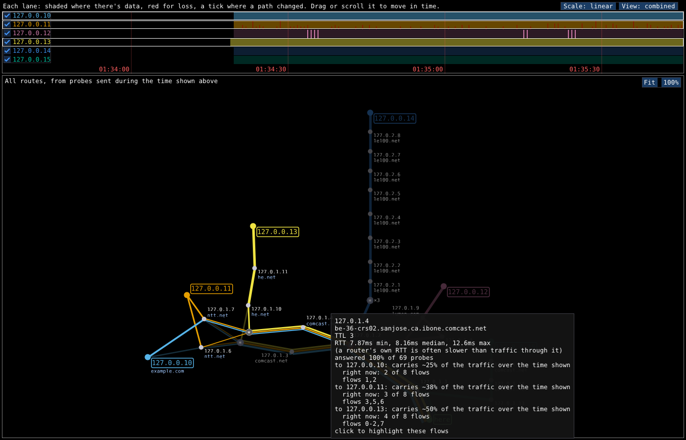

How the map is drawn:
* **Silent hops.** A run of hops that never answer is one node: "*", with
  "x5" beside it for five in a row. Until each hop in it has gone unanswered
  three times it's "?" instead - it might be a router that never answers,
  or a few probes that just got lost.
* **Routers that answer only some probes.** Many routers (home routers
  especially) only answer a few probes a second. When a flow hears nothing
  at a hop where every other flow coming from the same place heard from one
  router, it's drawn through that router too - not as a separate path - and
  that router's "answered x% of probes" shows the silence.
* **Layout.** It starts as a tree - "here" at the bottom, branches side by
  side where paths split, in whichever order of the hosts gives the fewest
  crossing links - and then physics takes over, with everything free to
  move: links pull like springs, the hosts and "here" push each other far
  apart (which spreads the map out), everything else keeps its neighbours at
  a distance, nodes and labels may not overlap, and links - as wide as their
  bundle of stripes - push away the nodes and labels they don't belong to.
  Height on the map isn't hop count; things go wherever the picture is
  clearest. A chain of three or more routers with no branches stays a rigid
  column, labels one above the other. Each label then takes whichever corner
  of its node is clearest.
* **Bigger than the window?** Drag the map to move it, scroll over it to
  zoom; "Fit" shrinks it to fit, "100%" puts it back to full size.
* As in the one-host view, the layout is redone whenever a new router (or
  silent hop) turns up, so expect some rearranging, mostly in the first
  minute.

**Traffic share.** Pings rotate evenly through the flows, so a router's
share of a host's traffic is the average, over the flows, of the fraction of
each flow's probes (at that hop, during the time shown) that it answered.
A flow whose route changed halfway through counts as half a flow. "Right
now" counts the flows whose most recent probe went through it - if the two
disagree, the route changed during the time shown. With 8 flows the
estimate moves in steps of 1/8, and only 8 of the router's hash buckets are
ever sampled, so treat it as rough; more flows (`--flows 16`) sharpen it.

**Time and loss on each link.** Every link is labeled with the time it
adds, and with the loss it adds if any was seen there: `38ms`, or
`38ms@2.1%` with loss (in red). The label lies along the link, on a dark
pill, when it fits between the dots; otherwise it sits level, beside it.
Each end of a link is judged by the best figures seen at it *or anywhere
beyond it*, up to the target (whose figures come from the pings): a router
that's slow to answer probes, or ignores some, can't make the hops after it
look bad, so its own quirks drop out, while a long cable, a queue or a lossy
link shows up, because every hop beyond it pays for it too. The time is the
difference between the fastest replies at the two ends; the loss, the far
end's loss net of the near end's.

While the data is thin, the figures are ranges - `~30-45ms`, `@~1.0-6.3%` -
and they narrow to single numbers as replies come in. (A floor's range runs
from "fastest minus the gap to the second fastest" up to the fastest; a loss
rate's is its 95% confidence interval.) Zoomed in to a short time, expect
ranges; zoom out for more data. Hover over a link for what its figures rest
on. Pings a router refused aren't counted as loss on any link: the refusal
is shown on the router. One caveat: a reply's trip back can take a different
path than the probe's trip out, so time a link "adds" may really be on the
way back.

A few more things worth knowing:
* A router's own round trip time is often slower and jumpier than the
  traffic passing through it: answering a probe is a chore for its CPU, done
  when it gets around to it. See "Why per-hop RTTs lie" below. The RTTs that
  count are the target's.
* The layout stays put while the routers stay the same. When a new one turns
  up, the map is laid out again - so it rearranges itself now and then,
  mostly in the first minute or so.
* If a target is anycast (many servers sharing one address), whichever copy
  answers is shown as the target.

**About the example images.** They're real pingem screenshots, but of
simulated networks: `docs/tools/fake_responder.py` answers pings to
127.0.0.2-5 with made-up delays (two routes chosen by checksum, delays chosen
per packet, a four-hop path with a jittery cable link, and so on), and plays
a whole small network of fake routers for 127.0.0.10-15, so each situation
can be shown on demand. Its header says how to run it to regenerate the
images. (The router names in the route images came from temporary
/etc/hosts entries.) The odd stray reply far above the bands is the
simulator's own timing noise.

The Unix socket speaks a plain-text line protocol (documented in
shared/protocol.h), so you can also drive user_icmp by hand:

    socat - ABSTRACT-CONNECT:user_icmp
    add 1 8.8.8.8 interval=1

# Purpose
I frequently leave ping running in a terminal so I have something to visually
query when real-time comms start misbehaving. If Zoom starts jittering, a quick
glance at a running ping will tell me if something has gone wrong with my net
connection or if the issue is on the other end. These are the kinds of paranoid
habits you develop when you're on AT&T "broadband."

I wanted something a little more long-term, though. Something that would show
me a longer-span history of my connection state. I created a tool called
pingstats that did just this for me, but it suffered from the restriction that
it could only run in iTerm2. I love iTerm2, it's amazing, but it's Mac only. I
wanted a solution that would make it possible to put out a presentable visual
and simplify the process of providing a UI.

The natural choice for UI work is JavaScript - even though I'm not really a
fan.  Unfortunately, JS has no ability to send ICMP packets, nor can it invoke
Ping.  ~~Maybe this would be possible with NodeJS~~ (it's not), but I really
wanted this tool to be something that had a minimal barrier to installation.
Expecting someone to have Node on their machine is a bit of a stretch. Python
and a web browser are far more realistic expectations. (Come to think of it -
maybe the "minimal barrier" requirement suggests that I should leave user_icmp
in Python? Ugh. Decisions.)

# What's With user_icmp.py?

Calling /usr/bin/ping for ICMP is fairly simple and gets us 99% of what we
need, but there's an edge case that precludes using any of the ping binaries
available in linux, OSX, or Windows. It all comes down to the fact that with
ping, you have no idea when a packet was sent.

This seems like a minor issue, but it led to an issue that couldn't be solved
or worked around. The ping binaries will only tell you when a packet arrives.
If you experience a long bout of packet loss, you can only guess which ICMP
sequence ids have been sent. You might assume that, given the interpacket
interval I, packet number X would be sent at time X*I. This is not the case.
Each packet is sent after the previous packet is successfully queued and AT
LEAST I seconds have elapsed.

This means that you can end up in a situation were the graph displays a long
bout of packet loss, but packets that were thought to be lost in the distant
past start arriving in the present. The UI can go back to historic metrics and
remove the reported lost packet, but this leads to a couple other issues.
First, what happens if an epoch (a column in the history) has its last packet
removed?  Do we display that as 100% packet loss or as no data? I would opt to
mark it as 100% loss, but there are times that this is not ideal. Secondly,
what happens if we lose icmp_sequence 0-1000, then receive 1001, and lose 1002?
We've already marked 1002 as lost at some point in the distant past and it
won't be re-recorded as lost in the current epoch. When 1001 arrives, do we
mark everything after it as in transit and start over with determining what has
timed out and what hasn't?

It's a lot of silly heuristics and guesswork that end up making for some very
convoluted edge cases in the code that make for lots of cross-interaction and
difficult debugging. I'd rather just know exactly when packet number 1000 was
sent.

There are a couple options here.

Option #1 is to wrap tcpdump with a minimal setuid process and continue using a
ping subprocess. A setuid root executable that reports just the icmp packets
that are associated with the user's sessions is attractive, but suffers from a
fatal flaw. When the network we're trying to reach is unavailable, no packet is
sent and we're back to guessing when icmp_seq # n was supposed to have been
sent.

Option #2 is to provide a service - also setuid - that the user can connect to
that will send and receive icmp traffic on the user's behalf. This allows us a
number of advantages. First, we can pack a wider icmp_seq in our custom-built
icmp packets. This is very convenient when you are sending millions of packets
and don't want to compensate for the default 16-bit ids. Second, even during a
total network outage we will still track icmp traffic that _should_ have been
sent, even if it wasn't. (When there's "no route to host", the ping executable
stops sending packets.) Basically, a network outage should look the same to the
user as any other string of losses. If this service includes a connection
method that can be reached by a browser running javascript, the project reduces
down to only two parts instead of the original three.

Hence, the rewrite. I went with option #2. The Python version could only ever
run as root, so it has now been rewritten in C++ (user_icmp/), which drops root
immediately after opening its raw socket.

A few things the C++ agent does differently:
* Packets carry only a 16-bit identifier and 16-bit sequence number for
  matching; the 64-bit sequence number and send time stay in the agent's table
  of outstanding packets. Those 8 header bytes are what every router must quote
  back in an ICMP error, so nothing depends on a payload surviving the trip.
* Every packet is scheduled individually and never sent in bursts. If the agent
  falls behind it skips ahead rather than catching up.
* A target dies the moment its client's connection closes. (The Python agent
  kept pinging orphaned targets forever.)
* The agent is the only clock: it timestamps pings when sent and replies when
  received.
* ICMP errors about our pings (Destination Unreachable, Time Exceeded) are
  matched to the ping they quote and reported to the client at once, instead
  of leaving the ping to time out as "lost".
* Route probes look exactly like their flow's pings on the wire (so they
  take the same path), but the agent's table knows which outstanding packets
  are probes, so a probe is never mistaken for a ping or counted as loss.

# Be gentle
Everything on the path between you and a target has queues. Back-to-back
packets can fill one and cause the loss you're trying to measure, and routers
treat ICMP aimed at their own CPUs as low priority and rate-limit it. A ping a
second per target tells you nearly everything a ping every 100 ms does.

# Route characterization and hop latency (design notes)

Route discovery is built (see "Routes" above); the per-hop latency analysis
later in this section is not, yet. Alongside its regular pings, user_icmp
sends occasional TTL-limited probes to discover the route(s) to each target,
the same way traceroute does. Two ideas from Paris traceroute make this work
in the presence of load balancing:

* **Flows.** Routers that spread traffic over parallel links mostly choose the
  link by hashing header fields - for ICMP, the checksum, or the identifier.
  If we hold both constant (the checksum by adjusting two "fudge" bytes in
  the payload to cancel out the changing sequence number), every packet in
  that "flow" takes the same forward path. Give each flow its own checksum
  and its own identifier and you get several flows, which may take different
  paths whichever field a balancer looks at. (Each flow also numbers its
  packets on the wire with its own 16-bit counter; the 64-bit sequence
  number the client sees stays in the agent's table.)
* **Probes share their flow's checksum and identifier,** so a TTL-limited
  probe follows the same path as the ordinary pings in its flow. That's what lets a route
  selected in the route graph light up in the heatmap: every reply belongs to
  a known flow, and every flow maps to a discovered path.

The rest of this section is about the hard part: deciding what the per-hop
round trip times are actually telling you.

## Why per-hop RTTs lie

A router forwards traffic in specialized hardware (the "data plane" or "fast
path"). When a probe's TTL runs out at a router, though, the reply - an ICMP
Time Exceeded - has to be **generated**, and that happens on the router's
general-purpose CPU (the "control plane" or "slow path"). That CPU's real job
is running routing protocols, so it treats generating ICMP as a low-priority
chore, and RFC 1812 section 4.3.2.8 explicitly allows routers to rate-limit
the ICMP errors they generate. Pinging a router's own address directly doesn't
help; that's answered by the same CPU.

So the RTT we measure to hop k is

    forward forwarding delay to k
      + time for k's CPU to get around to replying
      + delay of the reply on ITS way back (which may be a different path again)

The middle term is noise as far as your traffic is concerned. Traffic passing
*through* router k never waits on its CPU. The classic symptom is a hop that
shows 80 ms while every hop after it shows 20 ms. That's impossible if the 80
ms were real forwarding delay, because every later hop's packets went through
router k too.

Two tests try to separate real delay from slow-responder noise. Both rest on
the same ground rules:

1. **Only compare hops on the same forward path.** That means hops observed by
   flows that map to the same path, and never pooling probes across paths.
2. **Compare samples taken at the same time.** Probes rotate through every
   (flow, TTL) pair, so the samples for hop k and hop k+1 are interleaved over
   the same period. Never compare hop k from this morning with hop k+1 from
   this afternoon.
3. **Use rank-based statistics.** RTT distributions are skewed, have long tails
   and often several peaks (see the screenshot). Means and standard deviations
   describe them badly, and tests that assume a normal distribution are
   unreliable here. Everything below works on ranks or medians.
4. **Don't trust the minimum.** It's tempting because CPU delay only ever adds
   time, but it's a single sample, and the more hops there are, the more ways
   one lucky packet can produce an unrepresentative minimum. A low percentile
   (the 10th, say) keeps most of the benefit and is far more stable.

## Test 1: the downstream comparison

**Principle:** forwarding delay is cumulative. Any delay a packet suffers
being forwarded through router k is also suffered by every probe that
continues past k. So for the same path, hop k+1's RTTs should be no lower than
hop k's, apart from noise. If hop k's RTTs are reliably *higher* than hop
k+1's, the excess can't be forwarding delay. It's k's slow path, and we should
mark k as a "slow responder" rather than a bottleneck.

**The test: Mann-Whitney U (also called the Wilcoxon rank-sum test).** We have
n RTT samples for hop k (X) and m for a later hop (Y). The question is whether
a randomly chosen X tends to be larger than a randomly chosen Y.

1. Pool all n+m samples and rank them from smallest to largest (rank 1 =
   smallest). Tied values get the average of the ranks they span.
2. Let R be the sum of the ranks of the X samples.
3. U = R - n(n+1)/2. U counts, over all n*m (x, y) pairs, how many have x > y,
   with ties counting one half.
4. **Effect size:** A = U / (n*m) estimates P(X > Y). A = 0.5 means no
   tendency either way. A = 0.8 means hop k's RTT beats hop k+1's in 80% of
   pairings. This number is easy to read and matters more than the p-value
   (see the pitfalls).
5. **Significance**, for n and m above about 20 each, uses the normal
   approximation:

       mean(U) = n*m/2
       var(U)  = (n*m/12) * [ (n+m+1) - sum(t^3 - t) / ((n+m)(n+m-1)) ]

   where the sum runs over groups of tied values, each of size t. (With
   microsecond timestamps, exact ties are rare.) Then z = (U - mean(U)) /
   sqrt(var(U)), and for the one-sided question "is X larger?" p = 1 - Phi(z).
6. **Size of the excess - the Hodges-Lehmann estimator:** the median of all n*m
   differences (x - y). It's the rank-based answer to "how many milliseconds
   is hop k overstating?" With a few hundred samples per hop, computing all
   n*m differences is trivially cheap.

**Reading the result:**

| A (hop k vs. later hop) | p      | Meaning |
|-------------------------|--------|---------|
| clearly > 0.5 (>= ~0.7) | small  | Hop k is a slow responder. Gray it out and show its excess (the HL estimate) as "not real". |
| near 0.5                | large  | No evidence that hop k inflates. Its RTT is plausibly real. |
| clearly < 0.5           | small  | The normal case: delay builds up as you go further. |

**Which later hop?** Compare k against k+1, and also against the final
destination, which has the best-sampled distribution of all. If either
comparison shows an inversion, k's excess isn't real. Two tests per hop is a
multiple-comparisons issue; the simple, conservative fix is the Bonferroni
correction: require p < 0.05/2.

**A paired version.** Because probes rotate, a hop-k probe and a hop-k+1 probe
on the same flow are often sent within a second or two of each other. Pair
them up, take the differences d = x - y, and run the **Wilcoxon signed-rank
test** on the d's. Pairing cancels out whatever both probes had in common -
your Wi-Fi having a bad moment, say - which makes the test much more sensitive
for the same number of samples. If pairing is reliable enough in practice, it
should be the main test, with the unpaired version as a cross-check.

**Pitfalls:**

* **With enough data, everything is "significant".** Thousands of samples will
  make a 0.1 ms difference come out at p < 0.001. Always require a meaningful
  effect size (A, or an HL estimate of more than a millisecond or so) as well
  as a small p.
* **The samples aren't independent.** Congestion comes in episodes, so
  neighboring samples are correlated. That makes p-values look better than
  they are. Mitigations: thin the data (only use every Nth probe); or compute
  per-window medians (one-minute windows, say) and run the test on those, since
  fewer, more independent points give an honest p.
* **Return paths.** The Time Exceeded messages from k and from k+1 come back
  separately and may take different paths. A return-path difference can
  imitate an inversion, and nothing can correct for it. A large, persistent
  inversion is still almost always the slow path.
* **Rate limiting shows up as loss, not latency.** A router that only answers
  30% of probes, while later hops answer nearly all of theirs, is limiting
  ICMP generation; it is not dropping your traffic. Track each hop's response
  rate separately from loss, and never show non-answers at an intermediate hop
  as packet loss.
* **Silent hops.** Some routers never answer. Compare k with the next hop
  that does.

## Test 2: time correlation

**Principle:** real congestion changes over time - queues fill and drain - and
those changes carry through to everything downstream. If the link into hop k
is congested, then when hop k's RTT goes up, the endpoint's RTT should go up
too. Slow-path noise at k comes from k's CPU, not from the forwarding path, so
it should have no relation to what the endpoint sees.

**Building the data:** each hop-k probe is paired with the endpoint ping on
the same flow that was sent closest in time (pings go out every interval, so
there is always one within half an interval). That gives pairs (x_i, y_i):
hop-k RTT and endpoint RTT, measured at nearly the same moment.

**The test: Spearman's rank correlation, rho.** Rank the x's among themselves
and the y's among themselves, then compute the ordinary (Pearson) correlation
of the ranks:

    rho = 1 - 6 * sum(d_i^2) / (n(n^2 - 1))     (d_i = rank(x_i) - rank(y_i); exact when there are no ties)

rho near +1 means hop k and the endpoint rise and fall together; near 0 means
they're unrelated. Ranks make it insensitive to the occasional 2-second
outlier, which would swamp an ordinary correlation.

* Significance: t = rho * sqrt((n-2) / (1 - rho^2)), compared against Student's
  t distribution with n-2 degrees of freedom.
* Confidence interval: transform with z = atanh(rho). For Spearman's rho the
  standard error of z is about sqrt(1.06 / (n-3)) (Fieller, Hartley & Pearson,
  1957). Build the interval on z and transform back with tanh.

**The big confound: shared upstream delay.** Every hop's probes, and the
endpoint's pings, all pass through hop 1, which may well be your Wi-Fi. If the
Wi-Fi is jittery, *every* hop correlates with the endpoint, and the test
blames everything. The fix is a **partial correlation** controlling for an
upstream reference hop r (hop k-1, or the last hop before k that isn't a slow
responder):

    rho(k,end | r) = (rho_ke - rho_kr * rho_er) / sqrt((1 - rho_kr^2) * (1 - rho_er^2))

This asks: once you account for what hop r and the endpoint have in common,
does hop k still track the endpoint? If so, the time-varying delay was added
between r and k, and the link into k is where your traffic is getting held up.
(This needs probes to r, probes to k, and endpoint pings all close in time.
Rotation makes those triples sparser, which is one more reason to collect
plenty of data.)

**Pitfalls:**

* **No variation, no answer.** On a quiet path all RTTs are flat, rho is about
  0 everywhere, and that says nothing either way. Report "not enough variation
  to analyze", not "no congestion".
* **Route changes** mix two different situations together. Only analyze
  stretches of time in which the flow's path stayed the same.
* **Sample size.** To reliably detect a modest correlation (rho = 0.3, at 95%
  confidence with 80% power) you need about 85 pairs. Strong correlations
  (rho > 0.6) show up with 20-30.

## Putting the two together

| Downstream comparison     | Time correlation (partial) | Verdict |
|---------------------------|----------------------------|---------|
| k inflated vs. later hops | none                       | Slow responder. Ignore k's extra latency. |
| no inversion              | significant                | Real, varying congestion entering at k. This is the interesting one. |
| no inversion              | none                       | Hop is fine, or the path is too quiet to tell. |
| k inflated                | significant                | Both effects at once; or the return path is involved. Show the raw histograms and let a human judge. |

## The data budget

None of this is free. With one probe per ping, 1 ping/second, 4 flows and 12
hops, each (flow, hop) pair gets probed about once every 48 seconds. 30 samples
for one pair takes about 24 minutes. Flows that turn out to share a path pool
their samples, which helps a lot. Even so, the UI has to say "collecting..."
for a while before it can say anything, and it should always offer the raw
per-hop histogram (on mouseover), so the evidence is visible and not just the
verdict.

## Reading list

On the network side:
* RFC 792 - Internet Control Message Protocol. Defines what a Time Exceeded
  message quotes back: the IP header plus at least the first 8 bytes.
* RFC 1812 - Requirements for IP Version 4 Routers. Section 4.3.2.8 covers rate
  limiting of ICMP errors.
* Richard A. Steenbergen, "A Practical Guide to (Correctly) Troubleshooting
  with Traceroute", NANOG 45 (2009). The best single explanation of the slow
  path and how to read traceroute latency honestly.
* B. Augustin et al., "Avoiding traceroute anomalies with Paris traceroute",
  ACM IMC 2006. Flows, and keeping the checksum fixed.
* B. Augustin, T. Friedman, R. Teixeira, "Measuring Load-balanced Paths in the
  Internet", ACM IMC 2007.
* D. Veitch, B. Augustin, R. Teixeira, T. Friedman, "Failure Control in
  Multipath Route Tracing", IEEE INFOCOM 2009. The Multipath Detection
  Algorithm (MDA): how many flows to try at each hop before you can be
  confident you've found every next hop.

On the statistics side:
* H. B. Mann, D. R. Whitney, "On a Test of Whether one of Two Random Variables
  is Stochastically Larger than the Other", Annals of Mathematical Statistics,
  1947.
* F. Wilcoxon, "Individual Comparisons by Ranking Methods", Biometrics
  Bulletin, 1945. Both the rank-sum and the signed-rank tests.
* J. L. Hodges, E. L. Lehmann, "Estimates of Location Based on Rank Tests",
  Annals of Mathematical Statistics, 1963.
* C. Spearman, "The Proof and Measurement of Association between Two Things",
  American Journal of Psychology, 1904.
* E. C. Fieller, H. O. Hartley, E. S. Pearson, "Tests for Rank Correlation
  Coefficients. I", Biometrika, 1957. The standard error for Spearman's rho.
* M. Hollander, D. A. Wolfe, E. Chicken, *Nonparametric Statistical Methods*,
  3rd ed., Wiley, 2014. The textbook for everything above, including tie
  corrections and exact small-sample tables.
